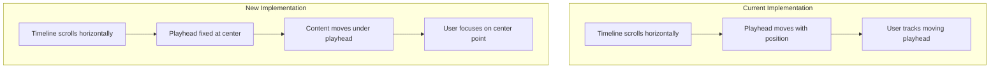
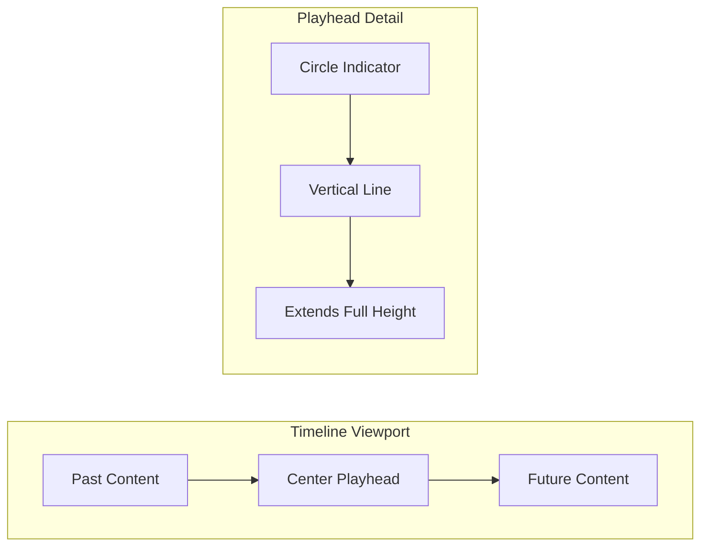
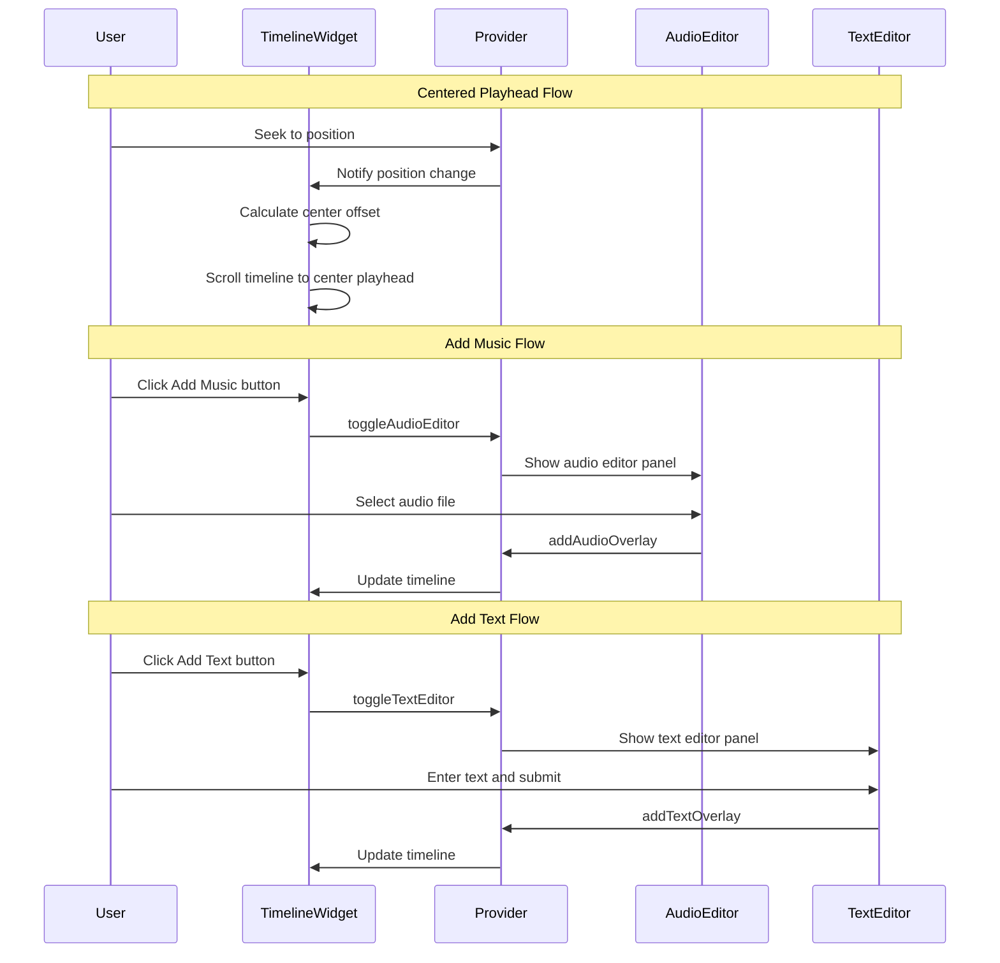

# Centered Keyframe & Quick Action Buttons Implementation Guide

## Overview

This guide details the implementation of a Filmora-style centered keyframe (playhead) system and quick action buttons for adding music and text in the Studio V video editor app.

## Current Architecture Analysis

### Key Files

| File | Purpose |
|------|---------|
| [`lib/widgets/timeline_widget.dart`](lib/widgets/timeline_widget.dart) | Timeline UI with tracks, playhead, and controls |
| [`lib/screens/video_editor_screen.dart`](lib/screens/video_editor_screen.dart) | Main editor screen with preview and bottom panels |
| [`lib/providers/video_editor_provider.dart`](lib/providers/video_editor_provider.dart) | State management for video editing |
| [`lib/widgets/text_overlay_editor.dart`](lib/widgets/text_overlay_editor.dart) | Text overlay creation/editing UI |
| [`lib/widgets/audio_overlay_editor.dart`](lib/widgets/audio_overlay_editor.dart) | Audio overlay creation/editing UI |

### Current Playhead Behavior

The current implementation in [`timeline_widget.dart`](lib/widgets/timeline_widget.dart:143-153) positions the playhead using:

```dart
Positioned(
  left: (_durationToPixels(provider.currentPosition) - 1).clamp(0.0, double.infinity),
  top: 0,
  bottom: 0,
  child: Container(width: 2, color: Color(0xFF7C4DFF)),
)
```

**Problem**: The playhead moves across the timeline as playback progresses, requiring the user to visually track it.

---

## Feature 1: Centered Keyframe System

### Concept

Like Wondershare Filmora, the playhead should remain **fixed at the center** of the visible timeline viewport while the timeline content scrolls beneath it. This provides:

- Consistent visual reference point
- Better focus on the current playback position
- Professional video editor UX pattern

### Architecture Diagram



### Implementation Details

#### 1.1 Timeline Widget Changes

**File**: [`lib/widgets/timeline_widget.dart`](lib/widgets/timeline_widget.dart)

##### Step 1: Add Center Playhead State

```dart
class _TimelineWidgetState extends State<TimelineWidget> {
  final ScrollController _scrollController = ScrollController();
  double _timelineScale = 0.01;
  static const double _trackHeight = 60.0;
  static const double _timelineHeight = 40.0;
  final GlobalKey _timelineContentKey = GlobalKey();
  
  // NEW: Track if we should auto-scroll to center
  bool _autoScrollEnabled = true;
  
  // NEW: Get viewport width for centering
  double _viewportWidth = 0;
```

##### Step 2: Add Viewport Width Tracking

```dart
@override
Widget build(BuildContext context) {
  return Consumer<VideoEditorProvider>(
    builder: (context, provider, child) {
      return LayoutBuilder(
        builder: (context, constraints) {
          _viewportWidth = constraints.maxWidth; // Store viewport width
          // ... rest of build
        },
      );
    },
  );
}
```

##### Step 3: Create Centered Playhead Widget

Replace the current playhead positioning with a Stack-based approach:

```dart
Widget _buildCenteredPlayhead(VideoEditorProvider provider) {
  return Positioned(
    left: _viewportWidth / 2 - 1, // Center of viewport
    top: 0,
    bottom: 0,
    child: IgnorePointer(
      child: Column(
        children: [
          // Top indicator triangle
          Container(
            width: 12,
            height: 12,
            decoration: const BoxDecoration(
              color: Color(0xFF7C4DFF),
              shape: BoxShape.circle,
            ),
          ),
          // Vertical line
          Expanded(
            child: Container(
              width: 2,
              color: const Color(0xFF7C4DFF),
            ),
          ),
        ],
      ),
    ),
  );
}
```

##### Step 4: Implement Auto-Scroll Logic

```dart
void _scrollToCenterPlayhead(Duration position) {
  if (!_scrollController.hasClients || !_autoScrollEnabled) return;
  
  final contentWidth = _getTimelineWidth(totalDuration);
  final playheadPixelPosition = _durationToPixels(position);
  
  // Calculate scroll offset to center the playhead
  final targetScrollOffset = playheadPixelPosition - (_viewportWidth / 2);
  
  // Clamp to valid scroll range
  final maxScroll = (contentWidth - _viewportWidth).clamp(0.0, double.infinity);
  final clampedOffset = targetScrollOffset.clamp(0.0, maxScroll);
  
  _scrollController.animateTo(
    clampedOffset,
    duration: const Duration(milliseconds: 100),
    curve: Curves.easeOut,
  );
}
```

##### Step 5: Add Scroll Listener for User Interaction

```dart
@override
void initState() {
  super.initState();
  _scrollController.addListener(_onScrollChanged);
}

void _onScrollChanged() {
  // Disable auto-scroll when user manually scrolls
  if (_scrollController.position.userScrollDirection != ScrollDirection.idle) {
    _autoScrollEnabled = false;
  }
}

void _enableAutoScroll() {
  _autoScrollEnabled = true;
  _scrollToCenterPlayhead(provider.currentPosition);
}
```

##### Step 6: Update Build Method Structure

```dart
@override
Widget build(BuildContext context) {
  return Consumer<VideoEditorProvider>(
    builder: (context, provider, child) {
      if (!provider.hasProject) {
        return const Center(child: Text('No project loaded'));
      }

      return LayoutBuilder(
        builder: (context, constraints) {
          _viewportWidth = constraints.maxWidth;
          final height = constraints.maxHeight;
          final bool showHeader = height > 220;
          final bool isCompact = height < 150;

          // Auto-scroll on position change
          WidgetsBinding.instance.addPostFrameCallback((_) {
            if (_autoScrollEnabled) {
              _scrollToCenterPlayhead(provider.currentPosition);
            }
          });

          return Column(
            children: [
              if (showHeader) _buildTimelineHeader(provider),
              Expanded(
                child: Stack(
                  children: [
                    // Scrollable timeline content
                    SingleChildScrollView(
                      controller: _scrollController,
                      scrollDirection: Axis.horizontal,
                      child: GestureDetector(
                        behavior: HitTestBehavior.translucent,
                        onHorizontalDragStart: (_) => _autoScrollEnabled = false,
                        onTapDown: (details) => _handleTapSeek(details.localPosition.dx, provider),
                        child: Container(
                          key: _timelineContentKey,
                          width: _getTimelineWidth(provider.totalDuration),
                          // Add padding on both sides for centering
                          padding: EdgeInsets.only(
                            left: _viewportWidth / 2,
                            right: _viewportWidth / 2,
                          ),
                          child: Column(
                            children: [
                              _buildTimeRuler(provider),
                              _buildTextOverlayTrack(provider),
                              _buildVideoTracks(provider),
                              _buildAudioOverlayTrack(provider),
                            ],
                          ),
                        ),
                      ),
                    ),
                    // Fixed centered playhead
                    _buildCenteredPlayhead(provider),
                  ],
                ),
              ),
              if (!isCompact) _buildTimelineControls(provider),
            ],
          );
        },
      );
    },
  );
}
```

#### 1.2 Provider Changes

**File**: [`lib/providers/video_editor_provider.dart`](lib/providers/video_editor_provider.dart)

Add a listener callback for position changes:

```dart
// Add to VideoEditorProvider class
Function(Duration)? onPositionChanged;

void setPositionChangeListener(Function(Duration) listener) {
  onPositionChanged = listener;
}

// In seekTo method, add:
Future<void> seekTo(Duration position) async {
  _currentPosition = position;
  _updateTimelineClock();
  onPositionChanged?.call(position); // Notify listener
  // ... rest of existing code
}
```

### Visual Representation



---

## Feature 2: Add Music Button

### Current State

The audio editor is accessed via the bottom toolbar icon button. The user wants a dedicated "Add Music" button that directly opens the audio section.

### Implementation

#### 2.1 Add Button to Timeline Header

**File**: [`lib/widgets/timeline_widget.dart`](lib/widgets/timeline_widget.dart:182-233)

Add a styled "Add Music" button to the timeline header:

```dart
Widget _buildTimelineHeader(VideoEditorProvider provider) {
  return Container(
    height: 50,
    decoration: BoxDecoration(
      color: const Color(0xFF111116),
      border: Border(
        bottom: BorderSide(color: Colors.white.withOpacity(0.08)),
      ),
    ),
    child: Row(
      children: [
        const Padding(
          padding: EdgeInsets.all(16.0),
          child: Text(
            'Timeline',
            style: TextStyle(
              color: Colors.white,
              fontSize: 16,
              fontWeight: FontWeight.bold,
            ),
          ),
        ),
        const Spacer(),
        
        // NEW: Add Music Button
        _buildAddMusicButton(provider),
        const SizedBox(width: 8),
        
        // NEW: Add Text Button  
        _buildAddTextButton(provider),
        const SizedBox(width: 8),
        
        // Existing buttons
        IconButton(
          icon: const Icon(Icons.equalizer, color: Colors.white),
          onPressed: () => _showMixerDialog(context, provider),
          tooltip: 'Mixer',
        ),
        IconButton(
          icon: const Icon(Icons.zoom_in, color: Colors.white),
          onPressed: () => _zoomTimeline(true),
          tooltip: 'Zoom In',
        ),
        IconButton(
          icon: const Icon(Icons.zoom_out, color: Colors.white),
          onPressed: () => _zoomTimeline(false),
          tooltip: 'Zoom Out',
        ),
      ],
    ),
  );
}
```

#### 2.2 Create Add Music Button Widget

```dart
Widget _buildAddMusicButton(VideoEditorProvider provider) {
  return Material(
    color: Colors.transparent,
    child: InkWell(
      onTap: () => _openAudioEditor(provider),
      borderRadius: BorderRadius.circular(20),
      child: Container(
        padding: const EdgeInsets.symmetric(horizontal: 12, vertical: 6),
        decoration: BoxDecoration(
          color: Colors.orange.withOpacity(0.2),
          borderRadius: BorderRadius.circular(20),
          border: Border.all(color: Colors.orange.withOpacity(0.5)),
        ),
        child: Row(
          mainAxisSize: MainAxisSize.min,
          children: const [
            Icon(Icons.music_note, color: Colors.orange, size: 18),
            SizedBox(width: 6),
            Text(
              'Add Music',
              style: TextStyle(
                color: Colors.orange,
                fontSize: 13,
                fontWeight: FontWeight.w600,
              ),
            ),
          ],
        ),
      ),
    ),
  );
}

void _openAudioEditor(VideoEditorProvider provider) {
  // Close other editors and open audio editor
  provider.toggleAudioEditor();
  
  // Optional: Auto-trigger file picker
  // This provides immediate action when button is clicked
  _selectAudioFileForOverlay(provider);
}

Future<void> _selectAudioFileForOverlay(VideoEditorProvider provider) async {
  try {
    final result = await FilePicker.platform.pickFiles(type: FileType.audio);
    if (result != null && result.files.single.path != null) {
      final audioFile = File(result.files.single.path!);
      
      // Get audio duration
      final player = AudioPlayer();
      await player.setFilePath(audioFile.path);
      final duration = player.duration ?? const Duration(seconds: 30);
      await player.dispose();
      
      // Add audio overlay starting at current position
      await provider.addAudioOverlay(
        audioFile: audioFile,
        startTime: provider.currentPosition,
        endTime: provider.currentPosition + duration,
      );
      
      if (mounted) {
        ScaffoldMessenger.of(context).showSnackBar(
          const SnackBar(content: Text('Music added successfully')),
        );
      }
    }
  } catch (e) {
    if (mounted) {
      ScaffoldMessenger.of(context).showSnackBar(
        SnackBar(content: Text('Failed to add music: $e')),
      );
    }
  }
}
```

---

## Feature 3: Add Text Button

### Implementation

#### 3.1 Create Add Text Button Widget

```dart
Widget _buildAddTextButton(VideoEditorProvider provider) {
  return Material(
    color: Colors.transparent,
    child: InkWell(
      onTap: () => _openTextEditor(provider),
      borderRadius: BorderRadius.circular(20),
      child: Container(
        padding: const EdgeInsets.symmetric(horizontal: 12, vertical: 6),
        decoration: BoxDecoration(
          color: Colors.green.withOpacity(0.2),
          borderRadius: BorderRadius.circular(20),
          border: Border.all(color: Colors.green.withOpacity(0.5)),
        ),
        child: Row(
          mainAxisSize: MainAxisSize.min,
          children: const [
            Icon(Icons.text_fields, color: Colors.green, size: 18),
            SizedBox(width: 6),
            Text(
              'Add Text',
              style: TextStyle(
                color: Colors.green,
                fontSize: 13,
                fontWeight: FontWeight.w600,
              ),
          ],
        ),
      ),
    ),
  );
}

void _openTextEditor(VideoEditorProvider provider) {
  // Close other editors and open text editor
  provider.toggleTextEditor();
  
  // Focus on text input field
  // This is handled by the TextOverlayEditor widget
}
```

---

## Complete Implementation Flow



---

## File Changes Summary

| File | Changes Required |
|------|-----------------|
| [`lib/widgets/timeline_widget.dart`](lib/widgets/timeline_widget.dart) | Major refactor for centered playhead, add music/text buttons |
| [`lib/providers/video_editor_provider.dart`](lib/providers/video_editor_provider.dart) | Add position change listener callback |
| [`lib/screens/video_editor_screen.dart`](lib/screens/video_editor_screen.dart) | Minor updates if needed for button integration |

---

## Testing Checklist

### Centered Playhead
- [ ] Playhead stays centered during playback
- [ ] Timeline scrolls smoothly under playhead
- [ ] User can manually scroll to disable auto-centering
- [ ] Auto-centering re-enables after seek
- [ ] Playhead visible at timeline start/end boundaries
- [ ] Zoom in/out maintains playhead centering

### Add Music Button
- [ ] Button visible in timeline header
- [ ] Clicking opens audio editor panel
- [ ] File picker opens for audio selection
- [ ] Audio overlay added at current position
- [ ] Success/error feedback shown

### Add Text Button
- [ ] Button visible in timeline header
- [ ] Clicking opens text editor panel
- [ ] Text input field receives focus
- [ ] Text overlay added at current position
- [ ] Success feedback shown

---

## Additional Recommendations

### 1. Visual Polish
- Add subtle shadow/glow to centered playhead
- Animate button hover states
- Add ripple effect on button clicks

### 2. UX Enhancements
- Show keyboard shortcuts tooltip on button hover
- Add "Return to Playhead" button when user scrolls away
- Consider mini-preview at playhead position

### 3. Performance
- Use `const` widgets where possible
- Implement timeline virtualization for long projects
- Cache timeline thumbnails

---

## Implementation Order

1. **Phase 1**: Centered Playhead
   - Update timeline widget structure
   - Implement auto-scroll logic
   - Add user scroll detection

2. **Phase 2**: Add Music Button
   - Create button widget
   - Connect to audio editor
   - Implement file picker flow

3. **Phase 3**: Add Text Button
   - Create button widget
   - Connect to text editor
   - Focus management

4. **Phase 4**: Polish & Testing
   - Visual refinements
   - Edge case handling
   - Performance optimization
