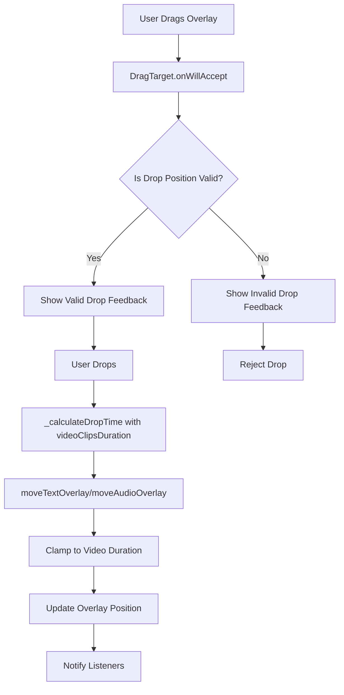

# Drag and Drop Position Optimization Plan

## Problem Analysis

The current drag and drop implementation for text overlays and audio overlays has the following issues:

1. **No Video Duration Constraint**: Text and audio overlays can be dragged beyond the video content duration, which doesn't make sense for video editing.

2. **Incorrect Duration Calculation**: The `totalDuration` getter in `VideoEditorProvider` includes overlay durations, creating a circular dependency when constraining overlay positions.

3. **Position Calculation Issues**: The `_calculateDropTime` method doesn't properly clamp the drop position to valid video content bounds.

## Current Implementation Issues

### In `timeline_widget.dart` (lines 1096-1121):
```dart
Duration _calculateDropTime(Offset globalOffset) {
  // ... calculation code ...
  final dropTimeMs = (timelineX / _timelineScale).round();
  return Duration(milliseconds: dropTimeMs.clamp(0, double.maxFinite.toInt()));
}
```
- Clamps to `double.maxFinite` instead of actual video duration
- No consideration for the video content length

### In `video_editor_provider.dart` (lines 1370-1390):
```dart
Future<void> moveTextOverlay(String overlayId, Duration newStartTime) async {
  // ... no constraint to video duration ...
  final updatedOverlay = overlay.copyWith(
    startTime: newStartTime,
    endTime: clampedEndTime,
  );
}
```
- No constraint to keep text within video bounds

### In `video_editor_provider.dart` (lines 278-298):
```dart
Future<void> moveAudioOverlay(String overlayId, Duration newStartTime) async {
  final maxTimeline = totalDuration; // This includes overlays!
  // ...
}
```
- Uses `totalDuration` which includes overlays, creating circular dependency

## Solution Architecture

### 1. Add `videoClipsDuration` Getter

Add a new getter in `VideoEditorProvider` that returns only the video clips duration:

```dart
Duration get videoClipsDuration {
  if (_currentProject == null) return Duration.zero;
  return _currentProject!.calculateTotalDuration(); // Only video clips
}
```

### 2. Update `_calculateDropTime` Method

Modify the method to accept and use video duration bounds:

```dart
Duration _calculateDropTime(Offset globalOffset, Duration maxDuration) {
  // ... existing calculation ...
  final dropTimeMs = (timelineX / _timelineScale).round();
  final maxMs = maxDuration.inMilliseconds;
  return Duration(milliseconds: dropTimeMs.clamp(0, maxMs));
}
```

### 3. Update `moveTextOverlay` Method

Constrain text overlays to stay within video duration:

```dart
Future<void> moveTextOverlay(String overlayId, Duration newStartTime) async {
  if (_currentProject == null) return;
  
  final overlayIndex = _currentProject!.textOverlays.indexWhere((o) => o.id == overlayId);
  if (overlayIndex == -1) return;
  
  final overlay = _currentProject!.textOverlays[overlayIndex];
  final duration = overlay.endTime - overlay.startTime;
  final maxVideoDuration = videoClipsDuration;
  
  // Clamp start time to keep overlay within video bounds
  Duration clampedStart = newStartTime;
  if (clampedStart < Duration.zero) clampedStart = Duration.zero;
  
  // Ensure overlay doesn't extend beyond video duration
  final maxStart = maxVideoDuration - duration;
  if (maxStart > Duration.zero && clampedStart > maxStart) {
    clampedStart = maxStart;
  }
  
  final updatedOverlay = overlay.copyWith(
    startTime: clampedStart,
    endTime: clampedStart + duration,
  );
  
  // ... rest of the method
}
```

### 4. Update `moveAudioOverlay` Method

Similar constraint for audio overlays:

```dart
Future<void> moveAudioOverlay(String overlayId, Duration newStartTime) async {
  if (_currentProject == null) return;
  
  final index = _currentProject!.audioOverlays.indexWhere((o) => o.id == overlayId);
  if (index == -1) return;
  
  final overlay = _currentProject!.audioOverlays[index];
  final duration = overlay.endTime - overlay.startTime;
  final maxVideoDuration = videoClipsDuration;
  
  // Clamp start time
  Duration clampedStart = newStartTime;
  if (clampedStart < Duration.zero) clampedStart = Duration.zero;
  
  // Ensure audio doesn't extend beyond video
  final maxStart = maxVideoDuration - duration;
  if (maxStart > Duration.zero && clampedStart > maxStart) {
    clampedStart = maxStart;
  }
  
  final updated = overlay.copyWith(
    startTime: clampedStart,
    endTime: clampedStart + duration,
  );
  
  // ... rest of the method
}
```

### 5. Add Visual Feedback for Drop Zones

Update the `DragTarget` widgets to show valid/invalid drop zones:

```dart
DragTarget<TextOverlay>(
  key: _textTrackKey,
  onWillAcceptWithDetails: (details) {
    // Check if drop would be within video bounds
    final dropTime = _calculateDropTime(details.offset, provider.videoClipsDuration);
    return dropTime >= Duration.zero && dropTime < provider.videoClipsDuration;
  },
  onAcceptWithDetails: (details) {
    final dropTime = _calculateDropTime(details.offset, provider.videoClipsDuration);
    provider.moveTextOverlay(details.data.id, dropTime);
  },
  builder: (context, candidateData, rejectedData) {
    return Container(
      // ... visual feedback based on candidateData/rejectedData
      color: rejectedData.isNotEmpty 
        ? AppColors.error.withOpacity(0.1)  // Red for invalid
        : candidateData.isNotEmpty 
          ? AppColors.textTrack.withOpacity(0.1)  // Green for valid
          : AppColors.surface,
    );
  },
)
```

## Implementation Flow



## Files to Modify

1. **lib/providers/video_editor_provider.dart**
   - Add `videoClipsDuration` getter
   - Update `moveTextOverlay` method
   - Update `moveAudioOverlay` method

2. **lib/widgets/timeline_widget.dart**
   - Update `_calculateDropTime` method signature and implementation
   - Update `DragTarget` callbacks for video, text, and audio tracks
   - Add visual feedback for valid/invalid drop zones

## Benefits

1. **User Experience**: Text and audio overlays stay within video bounds, preventing confusing edits
2. **Performance**: Reduced unnecessary calculations and invalid state handling
3. **Visual Clarity**: Users get immediate feedback when attempting invalid drops
4. **Code Maintainability**: Clear separation between video duration and total timeline duration

## Testing Checklist

- [ ] Text overlay cannot be dragged before video start (0:00)
- [ ] Text overlay cannot extend beyond video end
- [ ] Audio overlay cannot be dragged before video start
- [ ] Audio overlay cannot extend beyond video end
- [ ] Visual feedback shows for valid drop zones
- [ ] Visual feedback shows for invalid drop zones
- [ ] Multiple overlays can be repositioned independently
- [ ] Undo/redo works correctly with constrained positions
