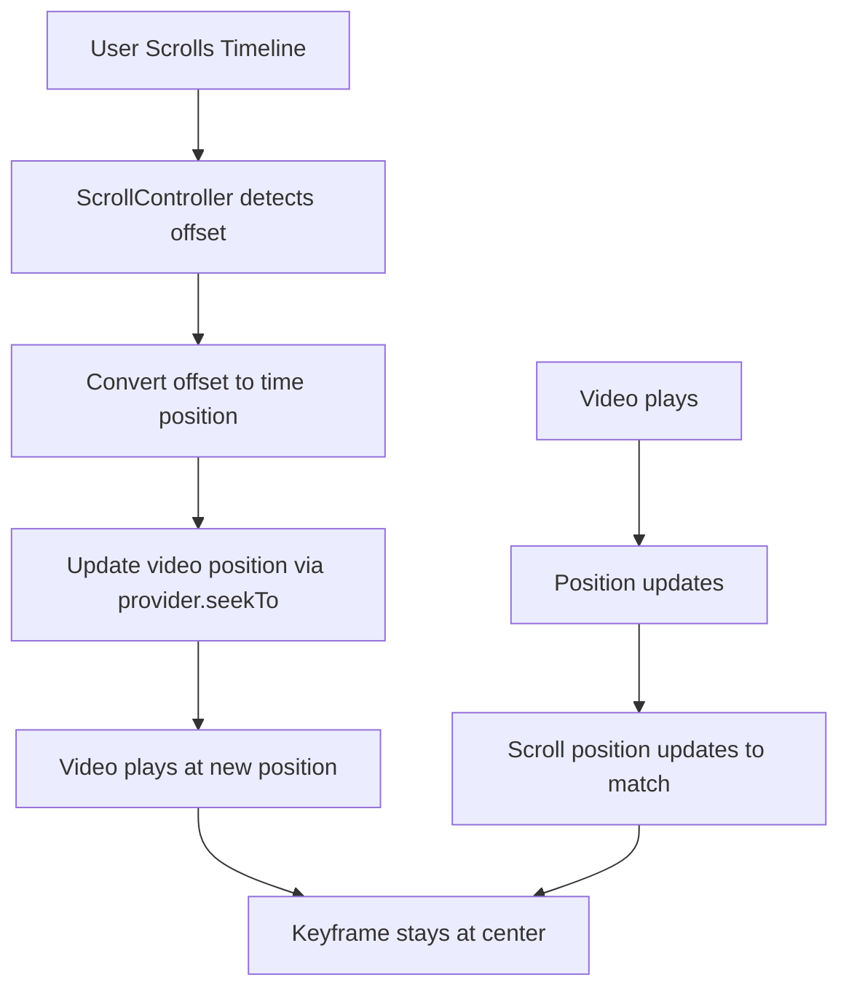

# Scroll-Based Timeline Navigation Implementation Guide

## Overview

This guide explains how to implement a Filmora-style timeline where:
1. The keyframe (playhead) is **fixed at the center** of the viewport
2. Scrolling the timeline **directly controls video position**
3. The keyframe and video timer are **always synchronized**
4. No "Return to Playhead" button is needed

## Current Issues

1. **"Return to Playhead" button exists** - Should be removed
2. **Scroll not working properly** - User cannot scroll to navigate
3. **Auto-scroll interfering** - Auto-scroll logic conflicts with manual scrolling

## Architecture



## Key Concepts

### 1. Bidirectional Synchronization

The timeline scroll position and video position must be **bidirectionally synchronized**:

| Direction | Trigger | Action |
|-----------|---------|--------|
| Scroll → Video | User scrolls timeline | Update video position |
| Video → Scroll | Video plays | Update scroll position |

### 2. Scroll Position = Time Position

The scroll offset directly maps to the time position:

```
time_position = scroll_offset / timeline_scale
scroll_offset = time_position * timeline_scale
```

### 3. Keyframe at Center

The keyframe is always at the center of the viewport. The timeline content scrolls beneath it:

```
Timeline Content: [----Track Content----]
Viewport:         [======VISIBLE AREA======]
Keyframe:                 ↓ (center)
                          |
```

## Implementation Steps

### Step 1: Remove Unnecessary State Variables

Remove these variables that are no longer needed:
- `_autoScrollEnabled` - No longer needed, always sync
- `_lastPosition` - No longer needed
- `_isSeekingFromScroll` - Will be replaced with better approach

### Step 2: Simplified State

```dart
class _TimelineWidgetState extends State<TimelineWidget> {
  final ScrollController _scrollController = ScrollController();
  double _timelineScale = 0.01;
  static const double _trackHeight = 60.0;
  static const double _timelineHeight = 40.0;
  
  double _viewportWidth = 0;
  bool _isUserScrolling = false;  // Track if user is actively scrolling
}
```

### Step 3: Scroll Listener Implementation

```dart
void _onScrollChanged() {
  if (_scrollController.hasClients && _isUserScrolling) {
    // User is scrolling - update video position
    final scrollOffset = _scrollController.offset;
    final positionMs = (scrollOffset / _timelineScale).round();
    final position = Duration(milliseconds: positionMs);
    
    final provider = Provider.of<VideoEditorProvider>(context, listen: false);
    if (provider.hasProject) {
      provider.seekTo(position);
    }
  }
}
```

### Step 4: Detect User Scrolling vs Programmatic Scrolling

Use `NotificationListener<ScrollNotification>` to detect user scrolling:

```dart
NotificationListener<ScrollNotification>(
  onNotification: (notification) {
    if (notification is ScrollStartNotification) {
      // User started scrolling
      _isUserScrolling = true;
    } else if (notification is ScrollEndNotification) {
      // User stopped scrolling
      _isUserScrolling = false;
    }
    return false;
  },
  child: SingleChildScrollView(...),
)
```

### Step 5: Sync Scroll to Video Position During Playback

When video plays, update scroll position:

```dart
// In build method, listen to position changes
if (!_isUserScrolling && provider.currentPosition != _lastSyncedPosition) {
  _lastSyncedPosition = provider.currentPosition;
  WidgetsBinding.instance.addPostFrameCallback((_) {
    _syncScrollToPosition(provider.currentPosition);
  });
}

void _syncScrollToPosition(Duration position) {
  if (!_scrollController.hasClients || _isUserScrolling) return;
  
  final targetOffset = position.inMilliseconds * _timelineScale;
  final maxOffset = _scrollController.position.maxScrollExtent;
  final clampedOffset = targetOffset.clamp(0.0, maxOffset);
  
  _scrollController.jumpTo(clampedOffset);
}
```

### Step 6: Remove Return to Playhead Button

Remove this widget entirely:

```dart
// REMOVE THIS:
if (!_autoScrollEnabled)
  Positioned(
    top: 8,
    right: 8,
    child: _buildReturnToPlayheadButton(provider),
  ),
```

### Step 7: Timeline Content Width

Ensure timeline content has proper width for scrolling:

```dart
Container(
  width: _getTimelineWidth(provider.totalDuration) + _viewportWidth,
  padding: EdgeInsets.only(
    left: _viewportWidth / 2,  // Center the start
    right: _viewportWidth / 2, // Center the end
  ),
  child: ..., // Timeline tracks
)
```

## Complete Widget Structure

```dart
@override
Widget build(BuildContext context) {
  return Consumer<VideoEditorProvider>(
    builder: (context, provider, child) {
      if (!provider.hasProject) {
        return const Center(child: Text('No project loaded'));
      }

      return LayoutBuilder(
        builder: (context, constraints) {
          _viewportWidth = constraints.maxWidth;
          
          // Sync scroll to video position during playback
          _syncScrollToPositionIfNeeded(provider);

          return Column(
            children: [
              _buildTimelineHeader(provider),
              Expanded(
                child: Stack(
                  children: [
                    // Scrollable timeline with notification listener
                    NotificationListener<ScrollNotification>(
                      onNotification: _handleScrollNotification,
                      child: SingleChildScrollView(
                        controller: _scrollController,
                        scrollDirection: Axis.horizontal,
                        child: _buildTimelineContent(provider),
                      ),
                    ),
                    // Fixed centered playhead
                    _buildCenteredPlayhead(),
                  ],
                ),
              ),
              _buildTimelineControls(provider),
            ],
          );
        },
      );
    },
  );
}

bool _handleScrollNotification(ScrollNotification notification) {
  if (notification is ScrollStartNotification) {
    _isUserScrolling = true;
  } else if (notification is ScrollEndNotification) {
    _isUserScrolling = false;
  }
  return false;
}
```

## Scroll Direction Behavior

| User Action | Scroll Direction | Timeline Content | Video Position |
|-------------|------------------|------------------|----------------|
| Swipe Right | Scroll increases | Content moves left | Time increases |
| Swipe Left | Scroll decreases | Content moves right | Time decreases |

**Important**: In Flutter, scrolling right (swiping right) increases the scroll offset, which should increase the time position.

## Testing Checklist

- [ ] Keyframe stays fixed at center of viewport
- [ ] Scrolling right increases video time
- [ ] Scrolling left decreases video time
- [ ] Video playback updates scroll position
- [ ] No "Return to Playhead" button appears
- [ ] Scrolling works smoothly without lag
- [ ] Video position and scroll position are always in sync

## Common Issues and Solutions

### Issue 1: Scroll not working
**Cause**: GestureDetector intercepting scroll events  
**Solution**: Remove unnecessary GestureDetectors, use NotificationListener

### Issue 2: Jittery scrolling
**Cause**: Feedback loop between scroll and video position  
**Solution**: Use `_isUserScrolling` flag to prevent updates during user scroll

### Issue 3: Video position not updating
**Cause**: Scroll listener not triggering seekTo  
**Solution**: Ensure provider.seekTo is called in scroll listener

## Files to Modify

1. **`lib/widgets/timeline_widget.dart`**
   - Remove `_autoScrollEnabled`, `_lastPosition` state variables
   - Add `_isUserScrolling` flag
   - Replace scroll listener logic
   - Add NotificationListener for scroll detection
   - Remove "Return to Playhead" button
   - Simplify scroll sync logic

## Summary

The key insight is that **scroll position = time position**. When the user scrolls, we update the video. When the video plays, we update the scroll. The keyframe never moves - it's always at the center showing the current time.
