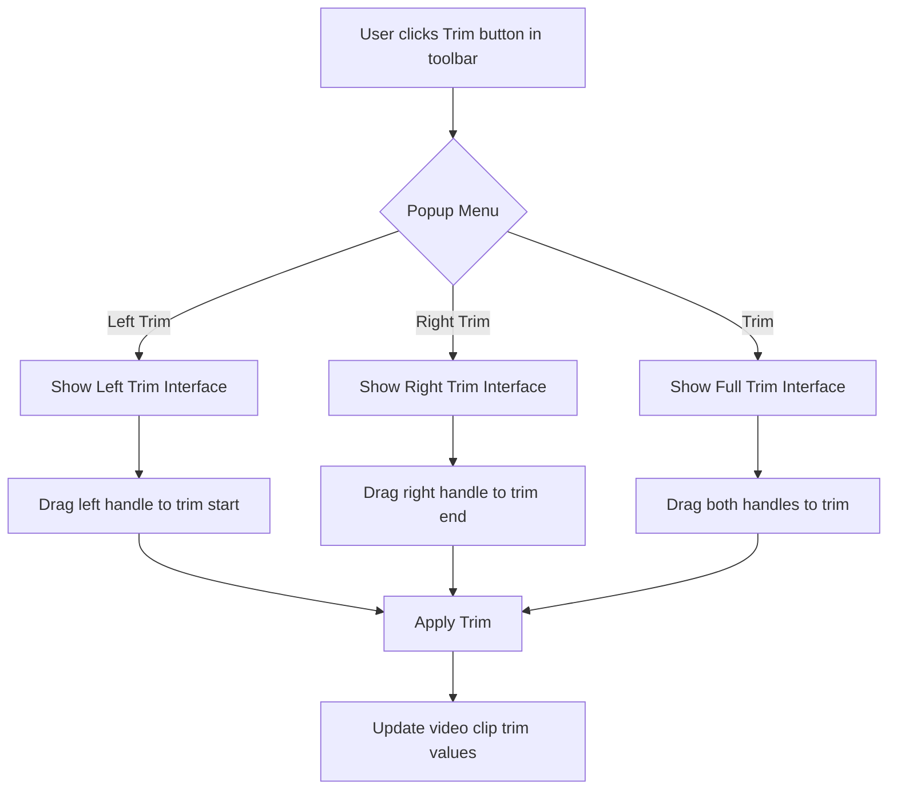
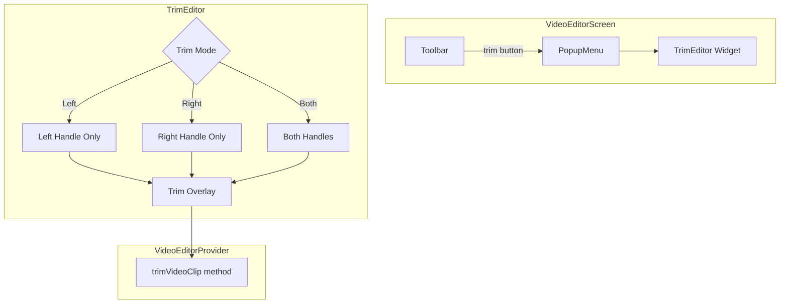

# Trim Options Implementation Plan

## Overview
Add three trim options (Left Trim, Right Trim, Trim) to the video editor, accessible from a popup menu in the toolbar.

## Reference Design Analysis
Based on the attached reference image:
- Video preview at top
- Toolbar with editing tools below video
- Three trim option buttons at bottom: "Left Trim", "Right Trim", "Trim"

## Implementation Steps

### 1. Add State Management (VideoEditorProvider)
- Add boolean flags: `showTrimEditor`, `isLeftTrimMode`, `isRightTrimMode`, `isTrimMode`
- Add toggle methods: `toggleTrimEditor()`, `setTrimMode(TrimMode mode)`
- Add trim methods using existing `trimVideoClip()` function

### 2. Add Trim Button to Toolbar (video_editor_screen.dart)
- Add new tool button with scissors/content_cut icon
- Show popup menu with three options when clicked:
  - "Left Trim" - opens left trim interface
  - "Right Trim" - opens right trim interface
  - "Trim" - opens full trim interface (both ends)

### 3. Create TrimEditor Widget (lib/widgets/trim_editor.dart)
- Create TrimEditor widget with three modes:
  - **Left Trim Mode**: Draggable handle on LEFT side only
  - **Right Trim Mode**: Draggable handle on RIGHT side only
  - **Trim Mode**: Draggable handles on BOTH sides
  
- UI Components:
  - Video preview area with trim overlay
  - Time indicators showing current trim positions
  - Draggable trim handles (similar to timeline)
  - Reset button to restore original
  - Apply/Cancel buttons

### 4. Integrate with Video Preview
- Show trim overlay on video when trim editor is active
- Display current trim start/end times
- Real-time preview updates as handles are dragged

### 5. Visual Styling
- Match reference design styling
- Dark theme consistent with app colors
- Smooth animations for handle interactions

## File Changes
1. **lib/providers/video_editor_provider.dart**
   - Add trim editor state and toggle methods

2. **lib/screens/video_editor_screen.dart**
   - Add trim button to toolbar
   - Add popup menu with three options
   - Add TrimEditor to bottom panel

3. **lib/widgets/trim_editor.dart** (NEW)
   - Create new widget with three trim modes

4. **lib/main.dart**
   - No changes needed (use existing AppColors)

## Mermaid Diagram - User Flow

## Mermaid Diagram - Component Structure

